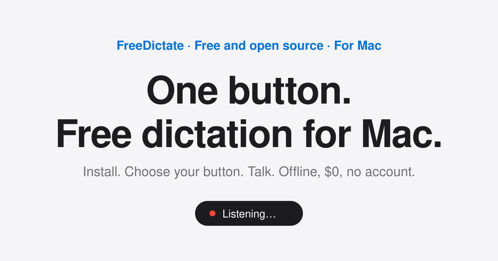

# FreeDictate

**One button. Free dictation for Mac.**

Install. Choose your button. Talk. That's it.

FreeDictate is free, open-source dictation for Mac. Hold one button, talk, and your words
appear in any app. It runs offline on your Mac with [whisper.cpp](https://github.com/ggml-org/whisper.cpp),
so nothing you say leaves your machine. No subscription, no account, no pro tier, nothing
to configure. A dead-simple alternative to Wispr Flow, Superwhisper and VoiceInk.

**Website:** https://owenmonagan.github.io/freedictate/



<!-- Demo GIF: add site/assets/demo.gif and reference it here. -->

## Install

One line:

```bash
curl -fsSL https://raw.githubusercontent.com/owenmonagan/freedictate/main/install.sh | bash
```

Or clone and run it yourself:

```bash
git clone https://github.com/owenmonagan/freedictate.git
cd freedictate
./install.sh
```

Then open Hammerspoon, grant it **Accessibility** and **Microphone** access, and reload its
config. The welcome window opens on first run.

## Use it

1. **Choose your button.** Any key, a key combo, a lone modifier (like Right ⌥), or a
   middle / back / forward mouse button.
2. **Talk.**
   - **Hold** the button, speak, release. Your text is pasted.
   - Or **tap** to start and **tap** again to stop, for longer dictation.
3. **Esc** cancels.

Text is pasted into whatever field has focus, in any app, and your clipboard is restored
afterwards.

## How it works

Everything runs locally:

- **[Hammerspoon](https://www.hammerspoon.org/)** runs the engine (`app/dictate.lua`): it
  listens for your button, shows the small on-screen indicator, and pastes the result.
- **[ffmpeg](https://ffmpeg.org/)** records 16 kHz mono audio from your mic.
- **[whisper.cpp](https://github.com/ggml-org/whisper.cpp)** transcribes it on-device with
  OpenAI's Whisper model, via a local `whisper-server` on `127.0.0.1` kept running by a
  launchd agent (falls back to `whisper-cli`).

No network calls, no account, no telemetry.

## Requirements

- macOS (Apple Silicon recommended)
- [Homebrew](https://brew.sh/)
- Hammerspoon, ffmpeg and whisper-cpp (the installer sets these up)
- A Whisper model file (the installer downloads it; ~0.5 GB)

## Uninstall

```bash
./uninstall.sh
```

Or, if you installed with the one-liner:

```bash
curl -fsSL https://raw.githubusercontent.com/owenmonagan/freedictate/main/uninstall.sh | bash
```

## Troubleshooting

| What you see | Fix |
|---|---|
| "Microphone access needed" | System Settings → Privacy & Security → Microphone → enable Hammerspoon. |
| "Copied instead — press ⌘V to paste" | System Settings → Privacy & Security → Accessibility → enable Hammerspoon. |
| "Can't reach speech engine" | Restart it from the menu bar item, or re-run `./install.sh`. Check `launchctl list \| grep whisper`. |
| "Nothing heard" | Check your input device in System Settings → Sound, and speak a little longer. |
| Button does nothing | Reload Hammerspoon's config and confirm `require("dictate")` is in `~/.hammerspoon/init.lua`. |

## Project layout

```
app/dictate.lua            engine (symlinked to ~/.hammerspoon/dictate.lua)
app/hud/                   on-screen indicator
app/onboarding/            welcome window
launchd/                   whisper-server launchd agent
site/                      website (GitHub Pages)
design/                    DESIGN.md, MOTION.md, tokens.css
install.sh / uninstall.sh  installer and uninstaller
```

## Contributing

Issues and pull requests are welcome. See [CONTRIBUTING.md](CONTRIBUTING.md) and the
[Code of Conduct](CODE_OF_CONDUCT.md). Security issues: see [SECURITY.md](SECURITY.md).

## Credits

- [whisper.cpp](https://github.com/ggml-org/whisper.cpp) by Georgi Gerganov and contributors (MIT)
- [Hammerspoon](https://www.hammerspoon.org/) (MIT)
- [OpenAI Whisper](https://github.com/openai/whisper) model (MIT)
- [ffmpeg](https://ffmpeg.org/)

## License

[MIT](LICENSE) © 2026 Owen Monagan
